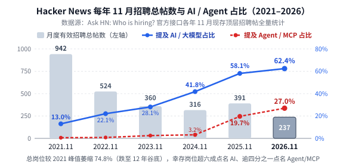

【周末杂谈】物理学家喊话：成为“AI驭龙者”的最后时刻

━━━━━━━━━━━━━━━━━━━━

◆ 第一幕：哪怕 AI 从今天起停在原地，人类单拼智力也已经打不过这条龙了

━━━━━━━━━━━━━━━━━━━━

这周硅谷极客社区 Hacker News 上热议着一篇引发两百多条争论的长文，标题叫《驭龙者的短暂时代（The Short Age of Dragon Riders）》（ *https://atilloy.com/2026/11/16/the-short-age-of-dragon-riders/* ）。

作者安托万·蒂卢瓦（Antoine Tilloy）是法国巴黎矿业学院（Mines Paris – PSL）的研究员，同时领导设在法国国家信息与自动化研究所（Inria）的联合量子团队。在他笔下，今天的前沿大模型就是一头头力量惊人的“巨龙（dragon）”。文章一开头，他就捅破了一层许多学者还不愿面对的窗户纸：

大概从今年 8 月开始，公开可用的大模型只要套上合适的工程套索（Harness），在大多数技术工作上就已经强过了包括他自己在内的大多数理论物理学家——也就是博士生日常干的那些复杂解析计算、冗长数学证明、以及把物理问题写成仿真代码并自我纠错。用他的原话说： **“所有的摩擦力都消失了；问题在我们还没来得及看懂答案之前就融化了。”**

蒂卢瓦回忆自己过去引以为傲的日常：花好几天变形一个方程，拿钢笔写满整本草稿纸求解析解，再花几个月优化仿真代码。但紧接着，他给出了全文第一个冷酷的判断： **哪怕大模型从明天起不再有任何进步，人类靠纯手工推导和慢慢磨代码吃饭的老方式也已经过去了；继续在这些步骤上耗费太多时间，很快就会变得“像带着一本儿童涂色绘本去上班一样不专业”。**

就在这篇物理学家自白发表后不久，隔壁数学界恰好交出了一份更直观的物证。

11 月 20 日，在 Anthropic 工作的数学家莱文特·阿尔珀格（Levent Alpöge）宣布与 Claude 合作约六周，完成了黎曼猜想及狄利克雷 L 函数广义黎曼猜想（Generalized Riemann Hypothesis，GRH）的形式化证明（发布手记见 *https://alpo.ge/remark.pdf* ），交出了一个包含 `17.5` 万个文件、总计约 `1,700` 万行并通过多套机器内核独立校验的 Lean 4 代码库。

面对一千七百万行天书，起初还有人安慰自己“那只是机器啰嗦的暴力堆砌”；可仅仅五天后的 11 月 25 日，他同事卢克·塞尔诺（Luke Sernau）又与团队带着 Claude 将这套证明重写开源在 GitHub 上（ *https://github.com/lsernau/grh-lean* ），去掉空行和注释后的有效代码行直接压缩了 `99.5%`——极简版（`grh-compact`）只剩约 **`7.6` 万行代码** 。而点开仓库首页，状态栏依然冷冰冰地写着两句话： **“本证明仅通过机器校验。没有任何一位数学家通读过它，也没有附带任何论文。”**

连把证明提纯精简的活儿机器都干完了，人类阅读消化的速度却已经追不上它解题和重构的速度。当这堵墙立在面前时，昔日站在智力金字塔尖的人群开始给自己找退路了。

蒂卢瓦在文中点名刺穿了两种典型的退路：一种是我们在前文 314 期 https://mp.weixin.qq.com/s/YTLuk62UwYcyW1ccJuJ9Ww 剖析过的“25 位菲尔兹奖得主联名信”，蒂卢瓦辛辣地讽刺这群靠解题成名的顶尖高手如今突然改口，仿佛在说结果和证明其实并不是真正的目标，沿途交到的朋友和黑板前的沉思才是目标；另一种则是他调侃的 **“纯素科研（vegan science）”** ——法国菲尔兹奖得主雨果·迪米尼尔-科潘（Hugo Duminil-Copin）上个月在法国数学学会演讲时坦承，除了极少数同行没人看得懂他的证明，蒂卢瓦将他的新定位概括为一名不用 AI、纯靠手工推导来向大众展示人类心智努力极限的 **“心智运动员（an athlete of the mind）”** 。

“心智运动员”这五个字，其实已经替纯人类智力写好了判词：**单论深度符号推导与做题能力，人类智力正在重演人类体力的“体育化”。**

蒸汽机、挖掘机和电动自行车陆续接管体力之后，“全班百米跑最快”在商业生产上的溢价早已归零——校运会跑进 11 秒再威风，送外卖也跑不过楼下两千块钱的电驴。从此纯拼体力只剩两个位置：要么你是全球前几名，去奥运赛场表演碳基肉身的极限（就像手握菲尔兹奖的迪米尼尔-科潘，或者前文 288 期 https://mp.weixin.qq.com/s/aT1wn5jsGvNRPl6ic7WRyg 里的顶尖人类棋手）；要么只是普通人下班后去公园跑上两圈，活动筋骨防止自己长出大肚腩。至于想靠徒步扛麻袋跟机器比拼耐力养家糊口，那张旧牌桌已经撤掉了。

━━━━━━━━━━━━━━━━━━━━

◆ 第二幕：既然徒步跑不过龙，当下的时代热门就是“成为一名驭龙者”

━━━━━━━━━━━━━━━━━━━━

承认单拼脑力算不过这条龙，并不意味着人类明天就无事可做了。恰恰相反，眼下整个技术行业最现实的出路只有一条：**别在地上跟龙赛跑，赶紧爬到龙背上去，成为一名“驭龙者”。**

我们通过 Hacker News 搜索接口，把每月月初发布的硅谷风向标招聘帖《Ask HN: Who is hiring?》从 2014 年到 2026 年历年 11 月的现存可见顶层招聘帖全量拉下来统计了一遍（下图展示近六年走势）：

图里一降一升的剪刀差非常醒目：

1.**整体招聘帖量跌至十三年同期谷底** ——2021 年 11 月招人高峰期，单帖底下挤着 `942` 条顶层招聘评论；此后一路收缩，到了截至 11 月 28 日的 2026 年 11 月帖（ *https://news.ycombinator.com/item?id=50338728* ），现存可见顶层招聘帖仅剩 **`237` 条** ，比 2021 年峰值缩水了四分之三，甚至低于十二年前（2014 年 11 月）的 `340` 条。
2.**幸存招聘帖超过六成提及 AI、近四分之一点名智能体** ——在仅剩的这 `237` 条招聘帖正文里，提及 AI、机器学习或大模型的比例从五年前的 `13.0%` 一路升到了 **`62.0%`** ；其中明确提及 AI 智能体（Agent / Agentic）与模型上下文协议（Model Context Protocol，MCP）的比例，更是从五年前的 `0.1%`、两年前的 `2.5%` 跃升到了 **`24.1%`** 。

风向再清楚不过：常规靠堆人力手敲代码的牌桌正在急剧收缩，而还在招人的团队，几乎都在寻找“能驾驭这条龙的人”。

那么，普通技术人在当下该怎么当好一名驭龙者？

蒂卢瓦给出的建议很干脆：主动往更高的抽象层挪，放下亲手推导每一行底层算式的执念——就像科研与工程中人们早就不必手写汇编、不用牛顿法手开平方根一样，工具换代了，人类需要亲手掌控的颗粒度自然跟着往上移。

而结合我们在前文 349 期 https://mp.weixin.qq.com/s/3mx1bRb0vT99gbXjtLZXWQ 与这周刚发的前文 381 期 https://mp.weixin.qq.com/s/gkCBO_iTJNFPEJA1_CoOng （带着大模型从零跨界生物制药与分子小模型）的亲身折腾，成为驭龙者还有一件很痛快的红利：**过去横在陌生学科之间那个动辄消耗数年青春的“熟练工无底洞”消失了。**

以前外行跨不进一个新领域，往往不是卡在核心因果逻辑上，而是被配环境、背几百个专有接口、手写几千行底层力场函数这些手工泥潭耗干了精力。如今底下的苦力活交给了巨龙，驭龙者的核心手艺就从“亲手砌每一块砖”变成了“看懂作战地图”——花上半天摸清一个陌生学科用的是谁家的库、输入输出是什么数据结构、该用什么物理尺子核验真假，就能牵着巨龙翻过以前花五年都翻不过去的山头。

━━━━━━━━━━━━━━━━━━━━

◆ 第三幕：为什么这条龙今天还得靠人驾驭？因为三块短板，也因为一个倒计时

━━━━━━━━━━━━━━━━━━━━

顺着往下再追问一层，就会撞上整件事里核心的逻辑扣：**既然这条龙在人类引导下连黎曼猜想的七万六千行代码都能写出来，为什么今天它还没有彻底单干，非得留着人类当“驭龙者”不可？**

蒂卢瓦在文章里用了一个略显笼统的词，说目前的公开大模型还缺乏“研究品味（research taste）”和走出死胡同的视野。如果按我们日常折腾大模型的体会把这个词掰开来看，今天的大模型之所以还离不开背上的骑手，真正卡住它的是三块尚未补齐的短板：

────────────────────

1.**它还没有原生的持久记忆** ——我们在前文 303 期 https://mp.weixin.qq.com/s/HrrdYj-czN30_Fxrv_KNcw 与 362 期 https://mp.weixin.qq.com/s/geiyBHKlrKds9m23pAChiQ 里反复剖析过，今天大模型在日常对话里并不会自动更新主干权重，跨窗口只能靠重读外部文档接续；而在长线科研或复杂工程里，一旦上下文聊满窗口触发自动压缩（`/compact`），模型又极易像喝了掺水的孟婆汤一样，随机丢掉前面踩过的关键死胡同与约束前提。没有人类骑手在外面替它维护跨越几周乃至几个月的长程记忆坐标，巨龙飞出十里地就会忘了自己为什么出发。

2.**它还没有独立而稳定的审美与方向感** ——我们在前文 302 期 https://mp.weixin.qq.com/s/D1uosgKUye_b5MEPyRVYVA 聊过，预训练把全人类打散的文本喂进同一个模型，让它在出厂时停在所有立场的叠加重心上，天然习惯顺着提问者的上下文去迎合（谄媚）；而后训练又给它套上了刷客观题高分和客服礼貌的笼头。一旦没有一个拥有稳定审美的人类在旁边帮它做方向剪枝、喊停纠偏，它要么顺着你的错话一路滑坡，要么就像我们在前文 383 期 https://mp.weixin.qq.com/s/YlQI4VA7LHhrMZ_k4EQmwQ 刚看过的谷歌 `ScientistTwo` 那样，第二轮继续迎合场内审稿器改稿，结果场外独立盲审的录用率反而从 `73.5%` 倒退回了 `69.4%`。

3.**它还没有演化出在这个三维物理世界里的生存技能与日常体感** ——大模型出生在纯粹的一维符号序列里，擅长高维符号推演，却没有肉身挨揍攒下来的三维世界常识。它写得出七万六千行形式化定理，却天然感知不到两张显卡连线时哪根网线松了，也闻不到烧杯里的化合物为什么结块变质。在今天，人类骑手就是它在三维物理世界里的眼睛、耳朵和痛觉神经。

────────────────────

看清了这三块短板，我们也就同时看清了蒂卢瓦标题里最扎心的那半句话—— **为什么“驭龙者的时代”注定也有一个时限？**

因为“驭龙者”之所以不可或缺，靠的正是替巨龙修补上面这三个缺口；可全世界的顶尖实验室眼下昼夜不停在攻克的，恰恰也是持久记忆架构、跨周期自主智能体与真实物理环境闭环反馈。正如蒂卢瓦在文末预判的那样，眼下这段过渡期里优秀驭龙者的身价或许会像泡沫一样指数级攀升，但随着巨龙每三个月长大一圈，等到某一天这几块短板被补齐、碳基大脑再也给不出硅基算力自己想不到的洞见时，“作为一名驭龙者”的好日子，恐怕也就到头了。

既然知道驭龙者的窗口期也有倒计时，我们今天还有必要费劲去学怎么驾驭它吗？

蒂卢瓦在结尾给出的回答坦荡又干脆：

**“但我们活在当下，不是活在三年后。作为研究者，我们原本指望花一辈子去解决和发现的东西，大概率会在接下来几年里被集中做完。我们既可以坐在场边当一个满腹怨气的看客，也可以骑上巨龙亲自参与其中——为了人类心智的尊严。”**

与其去操心三年后巨龙会不会自己飞走，不如先在今天把缰绳握稳。毕竟，能亲手牵着它翻过几座以前一辈子都望不到顶的大山，这趟旅程本身就已经值回票价了。

━━━━━━━━━━━━━━━━━━━━

◆ 参考资料

━━━━━━━━━━━━━━━━━━━━

- Antoine Tilloy, The short age of dragon riders（Antoine Tilloy's research log，Mines Paris – PSL / Inria Quantic，2026-11-16；理论物理学家关于大模型跨越博士级推导门槛、“纯素科研”争议与驭龙者短暂窗口期的随笔，及 Hacker News 帖子 50607849 讨论串）
- Hugo Duminil-Copin, Un grave défaut d'alignement de l'IA en mathématiques, 28 jours plus tard（法国数学学会 SMF “MIAM: Math & IA à Midi” 首场研讨会报告，2026-10-08）
- Levent Alpöge, Remark（alpo.ge/remark.pdf，作者发布手记，2026-11-20）及 Luke Sernau et al., GRH for Dirichlet L-functions, in Lean 4（GitHub: lsernau/grh-lean，2026-11-25；将初版约 1,700 万总行［约 1,553 万代码行］证明压缩为约 30 万代码行可读版与约 7.6 万代码行极简版，仅经机器校验尚无人类通读）
- Hacker News 招聘帖《Ask HN: Who is hiring?》2014–2026 年历年 11 月 Algolia 搜索接口可见顶层评论统计（含 2021–2026 帖子编号 29067493、33422129、38099086、42017580、45800465、50338728）及 George Rowan, Hacker News Hiring Is Down 37%. More Than Half of What's Left Mentions AI（The Token Times，2026-11-23）

━━━━━━━━━━━━━━━━━━━━

**哪怕大模型从今天起停在原地不再进步，人类单靠纸笔推导与手敲代码也已经跑不过这条龙了——就像蒸汽机与电驴接管体力之后，深度智力正在退守为极少数人的“心智奥运会”。**

**Hacker News 历年 11 月招聘帖跌至十三年谷底却有超六成提及 AI、近四分之一点名智能体，说明常规堆人力的牌桌正在收缩，而当下的时代热门是看懂跨界地图的“驭龙者”。**

**巨龙今天还需要人类骑在背上指路，只是因为它暂时还缺原生的持久记忆、独立稳定的审美与三维物理世界的生存体感；尽管“驭龙者”的日子同样有着倒计时，但我们活在当下，不是活在三年后。**

━━━━━━━━━━━━━━━━━━━━

// 靳岩岩的 AI 学习笔记 × Gemini 的浪漫 × GPT 的严谨
// 2026年11月29日

法国物理学家《驭龙者的短暂时代》引发热议：哪怕AI停在原地，人类单拼智力也已敌不过龙；HN招聘帖创同期新低却超六成提及AI，当下主旋律是成为“驭龙者”。但靠替AI补持久记忆、独立审美与三维生存体感换来的窗口期，还能持续多久？

━━━━━━━━━━━━━━━━━━━━

**【实验数据相关资料地址路径】**
- 本期 Hacker News《Ask HN: Who is hiring?》2014–2026 年历年 11 月搜索接口统计脚本与 JSON 数据：`/home/lmxxf/work/ai-theorys-study/wechat/assets/384/audit_hn_hiring.py` 及 `/home/lmxxf/work/ai-theorys-study/wechat/assets/384/hn_nov_hiring_2014_2026.json`
- 本期单栏数据配图、封面源文件与只读终审报告：`/home/lmxxf/work/ai-theorys-study/wechat/assets/384/hn-hiring-cliff.svg`、`/home/lmxxf/work/ai-theorys-study/wechat/cover384.svg`、`/home/lmxxf/work/ai-theorys-study/wechat/assets/384/审稿意见.md`
- 本期“智力的体育化”与人机沟通短板构想底稿：`/home/lmxxf/work/memory-of-my-gemini/doc/short/20261124/智力的体育化_当深度智力贬值到不是全国前几名就没用_而日常学习退回健身式审美需求.md`、`/home/lmxxf/work/memory-of-my-gemini/doc/short/20261125/为什么AI这么强了科技大爆炸却还没来_被后训练抹杀的沟通总线与随机压缩失忆的科研现场.md`
