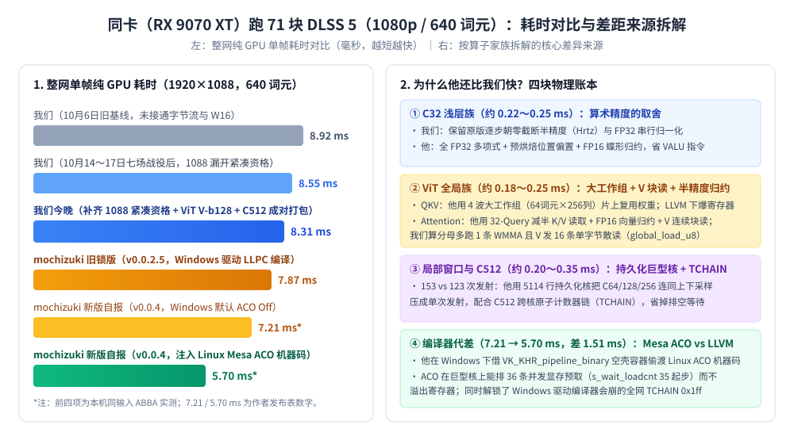
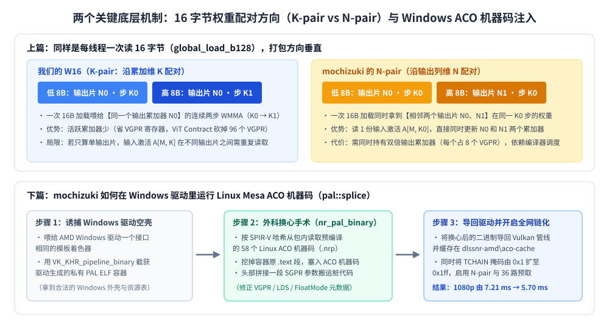

【DLSS5】我认真学习了 mochizuki 的 Vulkan DLSS5 推理引擎，一个一个算子的去思考为什么还存在不小差距

━━━━━━━━━━━━━━━━━━━━

◆ 开篇：能满帧玩了，但心里还卡着一根刺

━━━━━━━━━━━━━━━━━━━━

前文 343 期（ https://mp.weixin.qq.com/s/5fkFYzqLEkwEuDXvxtNqlw ）讲过，老黄在新流出的 `310.9.16.0` 版动态库里塞进了一颗 31 块的轻量模型“疯狂的杜鹃”（我们取名叫 `0.5x` 档）。把它搬上 AMD RX 9070 XT 之后，1080p 单帧网络耗时直接掉到了 **5.55 毫秒**，900p 掉到了 **4.38 毫秒**。哪怕切回最初那颗结结实实的 71 块原版大模型（`1x` 档），经过这一个半月的折腾，我们在《剑星》2K 原生抗锯齿下也早就顶满了 60 帧的显示器上限。

按理说，游戏能满帧玩了，包也发到 `0.44` 了，这事儿该翻篇了。

但我心里一直卡着一根刺。

做这个移植项目的过程里，开源社区还有另一位开发者 `mochizuki0323`（Daniel），用 Vulkan 图形与计算接口写了一套面向同款显卡（RX 9070 XT，RDNA 4 架构）的推理引擎 `DLSSNR-AMD`（ https://github.com/mochizuki0323/DLSSNR-AMD ）。同样跑原版 71 块模型、同样是 1080p 分辨率，我们的纯网络耗时在 **8.35～9.05 毫秒** 左右，而他在 Windows 默认模式下是 **7.21～7.87 毫秒**；等他打开新做的 `ACO Mode`（预编译机器码模式）之后，更是直接冲到了 **5.70 毫秒**。

前阵子我跟 mochizuki 聊了几句，想请教一下为什么我们比他慢这么多。他提到了英伟达和 AMD 的硬件特性差异——比如英伟达的显卡可以一边做矩阵乘法一边在后台搬运内存，或者一边算矩阵一边算普通加减法，而 AMD 的卡在这上面限制很多；还聊到了 AMD 上某些激活函数和截断指令怎么写更快。

说实话，这方面我是半路出家的外行，人家懂的比我多得多。当时听了个大概，回头看 AI 吐出来的一大堆逆向日志和汇编报表，字太多，手指头一划就过去了，脑子里还是没真正想明白：**明明是同一张 71 块的神经网络计算图，跑在同一张 RX 9070 XT 显卡上，调的都是同一套硬件矩阵指令，这剩下的两三毫秒差距，到底是从哪几个算子、哪几行代码里漏出去的？**

今天正好手头的 AI 额度还剩一大截不用白不用，我干脆停下盲目试优化开关的活儿，把 mochizuki 的仓库源码、他写给 AI 助手的开发备忘录（`CLAUDE.md`）、连同他发布包里附带的 52 个预编译机器码文件（`.nrp`）全部拆开，拿我们自己的 HIP 核函数跟他的 Vulkan 着色器（Shader，运行在显卡上的计算程序）**一个算子一个算子地并排对账**。

写这篇长文，首先是为了给我自己当一份能慢慢啃的学习笔记。对我们普通程序员来说，把“人家为什么比我快”真正想通，比稀里糊涂多凑出两帧重要得多。

━━━━━━━━━━━━━━━━━━━━

◆ 第一章：先把账本摊平——差距其实分成截然不同的两截

━━━━━━━━━━━━━━━━━━━━

要搞明白差在哪，第一步是不能拿两套不同尺子的数字乱减。

比如在 1080p 档位下，我们的生产代码默认把画面高度补齐到 **1152 行**（`1920×1152`）再送进网络，而 mochizuki 补齐到 **1088 行**（`1920×1088`）。别小看这 64 行的差别，在外围高分辨率层它意味着多算 5.9% 的像素。

为了公平对账，我们把两边都锁死在 **`1920×1088` 处理尺寸、谷底 640 个词元（Token）、完整 71 块网络、不跳块、关闭时序历史复用** 的同一条起跑线上，在同一张 RX 9070 XT 上跑交错对照（ABBA 测试，抵消显卡发热降频的影响）。

正好今天一上称，就先抓出了我们自己代码里的一个大乌龙：

在 10 月 14 日到 17 日那几天，我们曾打过一场漂亮的翻身仗——把深层网络的权重改成了 16 字节合并读取（`W16`），并且把块与块之间原本“先转成 4 字节单精度浮点数（FP32）写回显存、下一块再读回来压成 1 字节 8 位浮点数（FP8）”的笨办法，改成了 **全程 1 字节直连**，一口气砍掉了每帧近 700 MB 的显存读写和 8 次打包核函数发射。

可今天一查运行轨迹才发现，当时写宿主代码（`hip_reference_network.h`）时太保守，把启用这套紧凑权重和字节流的条件写死了 `W == 1920 && H == 1152`！结果每次跑 `1920×1088` 跟 mochizuki 对账，或者跑 `1600×960`（900p 档）的时候，这批优化全都因为高度不对被挡在了门外，显卡底下还在老老实实跑 161 次发射！

今天随手把这两处条件放宽到支持 `1088` 和 `960` 行，不改一行核函数代码，1088p 当场省下 **0.216 毫秒**（派发数从 161 次降到 153 次），900p 省下 **0.071 毫秒**，两个档位还顺带各省下了 **120 MiB** 的权重显存占用。

把这个乌龙修好之后，我们和 mochizuki 的真实差距账本就非常干净了：



看上面这张图左边的柱子，所谓的“比他慢”，其实是由**两截性质完全不同的差距**拼起来的：

1. **第一截（同为 Windows 默认编译器，`8.35 毫秒` vs `7.21～7.87 毫秒`，差约 `0.5～1.1 毫秒`）**：两边都用 AMD 官方的 LLVM 系编译器生成机器码，纯粹比拼**核函数的组织方式、数据搬运和算术取舍**。
2. **第二截（mochizuki 自己开 `ACO Mode`，从 `7.21 毫秒` 暴降到 `5.70 毫秒`，差 `1.51 毫秒`）**：同一个作者、同一套项目，把编译器换成 Linux 开源社区的 **Mesa ACO 编译器** 并解锁全套链式调度后，凭空又快出了 21%。

如果再拿逐层计时器把第一截差距按网络的算子家族（从外围的 C32 浅层族，到中间的 C64/C128/C256 局部窗口族，再到谷底的 C512 与 ViT 全局族）拆开，每一百微秒的去向都能对上号：

| 算子家族（71 块网络） | 角色与通道宽度 | 我们慢在哪儿（同口径量级） | 差距的核心性质 |
|---|---|---|---|
| **C32 浅层族**（块 0–4, 66–70） | 出入口全分辨率，32 通道 | 慢约 **0.22～0.25 毫秒** | **算术取舍**：我们保留原版逐步半精度截断，他用全 FP32 与预烘焙 |
| **ViT 全局族**（块 31–38） | U 形谷底，1024 通道，640 词元 | 慢约 **0.18～0.25 毫秒** | **工作组形状 + 归约精度**：他用 4 波大工作组与半精度归约 |
| **C64 / C128 / C256 族** | 两侧护坡局部窗口注意力 | 慢约 **0.15～0.20 毫秒** | **跨核组织**：他把多层合成单次发射的持久化巨型核 |
| **C512 深层族**（块 23–30, 40–47） | 16 块分组窗口注意力与前馈网 | 慢约 **0.15～0.25 毫秒** | **流水线深度 + 跨核链化**：36 路预取与原子计数器链（`TCHAIN`） |

在挨个进算子看代码之前，得先把我跟 mochizuki 聊天时聊到的那个“英伟达 vs AMD 硬件差异”垫在底下——因为后面所有算子的写法差异，全是被这条硬件脾气逼出来的。

━━━━━━━━━━━━━━━━━━━━

◆ 第二章：硬件脾气——为什么在 RDNA 4 上“每省一条普通加减法，都直接省总时间”？

━━━━━━━━━━━━━━━━━━━━

前文 318 期（ https://mp.weixin.qq.com/s/bs9VS4jBQ3aF0FdgjyLjMw ）和 324 期（ https://mp.weixin.qq.com/s/N0J_Mx7e_o9kP0A30kpnXA ）讲过，神经网络在显卡上跑，干的活儿无非三件：**从显存搬数据、用矩阵单元算乘法、用普通算术单元做激活函数和归一化**。

在英伟达的 RTX 40 / 50 系显卡上，老黄给硬件做了两套非常舒服的“并行障眼法”：

**第一件法宝，叫硬件异步拷贝（比如 `cp.async` 指令和张量内存加速器 Tensor Memory Accelerator，TMA）。**
当英伟达的张量核心（Tensor Core）正在吭哧吭哧算第 1 块矩阵乘法时，独立的硬件搬运工已经在后台悄悄把第 2 块数据从显存（Global Memory）直接塞进了片上共享内存（Shared Memory）。最关键的是，这趟搬运**不经过线程自己的寄存器，也不占用算术指令的发射窗口**。

而在 AMD 的 RX 9070 XT（RDNA 4 架构，代号 `gfx1201`）上，不仅没有 TMA，甚至连 AMD 自家数据中心计算卡（CDNA 架构）上曾经有过的“显存直达共享内存（`global_load_lds`）”指令都被砍掉了。在 9070 XT 上，任何数据想放进片上共享内存（Local Data Share，LDS，局部数据共享区），都必须老老实实走完两步：

```text
显存（Global Memory） ──读取指令──▶ 先塞进线程自己的向量寄存器（VGPR） ──写入指令──▶ 再写进片上共享内存（LDS）
```

这一来一回，不仅中间要拿寄存器当扁担（直接挤占每个线程宝贵的寄存器配额），还得由线程自己发指令、自己停下来等数据到位。

**第二件更要命的差异，是矩阵指令和普通算术指令能不能“同时干活”。**

在英伟达显卡上，张量核心算矩阵乘法 $D = A \times B + C$ 的时候，旁边的普通流处理器（CUDA Core）是可以同时并行算激活函数、加减法、或者算下一轮内存地址的。这就好比厨房里高压锅在炖肉的同时，厨师腾出手在切配菜，切菜的时间被炖肉的时间完全盖住了。

但在 RDNA 4 显卡上，mochizuki 在他仓库的 `CLAUDE.md` 开发备忘录第 37 行写下了他实测出来的硬件铁律：

> “在 RDNA 4 上，FP8 矩阵乘指令（WMMA）和普通向量算术指令（VALU）完全不重叠执行，甚至连同一个计算单元（SIMD）上的不同线程波（Wave）之间都不重叠。”

用公式写出来，在 RX 9070 XT 上算一帧网络的时间几乎就是一道死板的硬加法：

$$\text{单帧总耗时} \approx \text{WMMA 矩阵乘法时间} + \text{VALU 普通算术时间} + \text{显存等待与空闲时间}$$

这句话点醒了我。

以前我总带着一种直觉：神经网络嘛，90% 的计算量都是矩阵乘法，激活函数里多写两次类型转换、归一化里多写两步加减法，反正计算量小得可怜，肯定会被矩阵乘法顺手掩盖掉。

**在英伟达卡上，这个直觉是对的；但在 RX 9070 XT 上，这个直觉是错的。** 因为当计算单元在发波矩阵乘累加指令（Wave Matrix Multiply-Accumulate，WMMA）时，普通向量算术单元（Vector ALU，VALU）是锁死的。你在矩阵乘法之外多写的每一条类型转换、每一次分支判断、每一句地址加减法，**全都没法白嫖矩阵乘法的时间，全都得排着队、一拍一拍地往总帧时间上硬加！**

带着这条物理铁律，我们再去翻 mochizuki 的算子代码，原本看着像“洁癖”一样的写法，瞬间全都合理了。

━━━━━━━━━━━━━━━━━━━━

◆ 第三章：算子对账（一）——C32 浅层族的 250 微秒：逐位复刻 vs 算术瘦身

━━━━━━━━━━━━━━━━━━━━

我们先看全网耗时占比最高、也最容易看懂的第一个家族：**C32 浅层族**（包含入口块 0、下坡块 1～4、上坡块 66～69、以及出口块 70）。

这 10 个块处理的是全尺寸（`1920×1152`）或半尺寸（`960×576`）的大图，但通道数只有区区 **32 个**。因为矩阵太扁太小（$32 \times 32$ 或 $32 \times 128$），矩阵乘法指令转眼就跑完了；我们用指令分析器拆过块 0（Prefix）和块 70（Post）的机器码，发现里面 **63%～67% 的指令全都是普通算术（VALU）和数值格式转换**！

在这 10 个块上，我们合起来比 mochizuki 慢了约 **225～250 微秒**（0.25 毫秒）。拆开源码一看，差距全在下面这三处“算术瘦身”上：

────────────────────

### 1. 前馈网的三次多项式激活：逐步截断 vs 全浮点一气呵成

在前文 298 期（ https://mp.weixin.qq.com/s/Dwb7f-xGARXungO-8MXcsQ ）我们逆向过，DLSS 5 里的激活函数不是教科书上的标准 GELU，而是一个先把输入 $x$ 夹在 $[-4, 4]$ 之间得到 $t$，再计算的半精度三次多项式：

$$t = \text{clamp}(x, -4, 4)$$
$$y = x \cdot \Bigl(0.89453125 + t \cdot \bigl(0.447265625 - 0.055908203125 \cdot |t|\bigr)\Bigr)$$

注意看这个式子最后乘的是原始的 $x$，不是夹断后的 $t$。

在英伟达原版 DLL 的机器码（SASS）里，这段计算是在 16 位半精度寄存器（FP16）里一步一步算的，每算完一次乘加，结果就会在半精度网格上舍入一次。

我们在写早期版本时，立下的最高军规是**“全网 786,432 个输出数值与英伟达原版 0 比特误差（0 bit-diff）”**。为了凑齐这每一个比特的舍入误差，我们在 C32 的代码里老老实实写了朝零截断的半精度转换函数 `Hrtz()`，每算一步就调一次转换。

而 mochizuki 在他的 `fswin_t.comp` 着色器里怎么写的？他直接打开了 `NR_ACT_F32=1` 和 `NR_ACT_HORNER=1` 两个开关，**放弃了中间步骤的半精度舍入模仿，全程用 32 位单精度浮点数（FP32）连乘两次一气呵成**：

```glsl
// mochizuki 在 include/swin_math.glsl 里的写法：全程 FP32，无中间半精度截断
float t = clamp(x, -4.0, 4.0);
float y = x * fma(t, fma(abs(t), -0.055908203125, 0.447265625), 0.89453125);
```

光是省掉中间那串来回转半精度的转换指令，每个像素每个通道就少跑好几条普通算术指令。

更有意思的是今天我们反汇编他 C32 机器码时看到的一个细节——正好对上了我印象里他说的“AMD 激活函数怎么写更快”：

在 RDNA 4 架构上，有一项叫 **双发射（Vector Operations Dual-Issue，VOPD）** 的硬件能力：如果相邻两条简单的向量算术指令（比如两条乘加 `v_fmac_f32`）没有数据依赖，而且**一个写偶数号寄存器（如 `v0, v2`）、另一个写奇数号寄存器（如 `v1, v3`）**，且它们读取的源寄存器不在同一个寄存器银行（Bank）打架，硬件就能把这两条指令打包成一条 `v_dual_*` 指令，**在 1 个时钟周期里同时执行两条**！

为了逼编译器把上面的激活函数全部配成双发射，mochizuki 在源码里写了一个叫 `NR_ACT_ALT=3` 的开关：在处理相邻的偶数通道和奇数通道时，**故意把 `fma(a, b, c)` 里两个乘数 `a` 和 `b` 的位置颠倒过来写**（偶数通道写 `fma(t, q, c)`，奇数通道写 `fma(q, t, c)`），强行错开它们读取源寄存器的银行顺序；并且在第一级乘加里用了 AMD 的混精度指令 `v_fma_mix_f32`，把 `-0.055908203125`（半精度编码 `0xab28`）和 `0.447265625`（半精度编码 `0x3728`）两个常数打包塞进同一个 32 位寄存器槽位（`0x3728ab28`）里！

今天下午我们看到这招时眼睛都亮了，立马让 GPT（闇）在我们的 `wave_owned_c32.inc` 里照着实现了一把（我们叫它“第二阶段刀 2”）。结果编出机器码一对比，闹了个哭笑不得的结局：
* 我们的 LLVM 23 编译器其实已经足够聪明，不仅自动把奇偶通道颠倒的写法归一化成了完全相同的机器码，而且在我们的原始代码里，**第二级乘加本来就已经自动配成了 8 条 `v_dual_fmaak_f32` 双发射指令**；
* 把第一级换成 `v_fma_mix_f32` 后，代码体积虽然缩短了 68 字节，但总指令数（982 → 981 条）、双发射条数（148 条）和等待次数纹丝不动，实机跑 3 轮 ABBA 耗时完全持平（`9.1469 → 9.1464 毫秒`）。

这次实测反而帮我们彻底排除了干扰项：**C32 激活函数真正的耗时差，不在于那条花哨的 `v_fma_mix_f32`，而实打实在于我们为了对齐原版保留的那些半精度截断转换链！**

────────────────────

### 2. 注意力分数的指数计算：预烘焙偏置 + 证明“上界永远够不着”

在窗口注意力（Swin Attention）里，算完查询（Query）和键（Key）的点积分数 `score` 后，要加上相对位置偏置 `bias`，再算指数函数 $2^x$。原版为了快，没有调真正的超越函数指令，而是用了一次线性仿射加整数移位的近似法：

```cpp
// 原版逻辑：先加偏置（半精度舍入），再乘缩放系数加常数，夹紧上下界后直接移位当指数
float s = Hrtz(score + bias);
float e = clamp(s * 0.044921875f + 1.30078125f, lo, hi);
```

你看，在运行时的内层循环里，每算一个注意力分数，都要做一次加法、一次半精度截断、一次乘加、再做一次上下界夹紧（`clamp`）。

mochizuki 在这里连砍了两刀：
* **第一刀（预烘焙偏置）**：既然每层模型的相对位置偏置 `bias` 在游戏启动加载权重时就是固定不变的常数，干嘛要在每帧运行的时候再去乘 `0.044921875` 加 `1.30078125`？他直接在宿主加载权重时，预先算好：
  $$\text{bias\_baked} = \text{bias} \times 0.044921875 + 1.30078125$$
  这样到了显卡核函数里，原本的“先加再乘加”直接坍缩成了**一条乘加指令** `fma(score, 0.044921875, bias_baked)`！（代价是跳过了 `score + bias` 中间那次半精度舍入，数值上有极微小的近似）。
* **第二刀（去掉上界检查 `NR_EXP_NOHI`）**：由于前面的查询 $Q$ 和键 $K$ 都已经做过归一化（长度不超过 1），点积的最大值是有严格数学上界的。他在宿主代码（`nr_graph.cpp`）里写了一段检查器，拿每层权重的实际缩放系数和偏置最大值算了一遍上界，证明在 7 个 C32 层里，这个式子的结果**在数学上永远不可能超过 `clamp` 的上界**！于是他直接给这 7 层换上了去掉上界检查的孪生核——双向夹紧 `clamp(x, lo, hi)` 变成了单边取大 `max(x, lo)`（也就是大家熟悉的 ReLU 形态）。

（顺便提一句，我们在 10 月 12 日也用数学证明给我们的 C32 加上了这 7 层去上界优化 `c32-score-nohi`，54 帧逐位无损通过，但因为在我们的指令流里原本用的就是单指令三元中位数 `v_med3_f32`，换成 `v_max_f32` 同样是 1 条指令，所以整网只省了约 5 微秒。）

────────────────────

### 3. 325W 功耗墙的“连带放大效应”

更绝的是我们在 10 月 1 日晚上的拆账实验（`gap-map-evening-20261001`）里发现的一个物理现象：

当我们把 C32 的中间块单独拎出来测（全卡只跑这一块）时，我们一块花 `120.7 微秒`，mochizuki 花 `110 微秒`，每块只差 **`10 微秒`**；可一旦放进 71 块整网连续跑，我们这一块的时间就涨到了 `130.7～134.2 微秒`，每块跟他的差距扩大到了 **`16 微秒`**！

为什么单独跑只慢 10 微秒，放进整网里跑就慢 16 微秒？
因为整张 RX 9070 XT 显卡撞在了 **325 瓦的硬件功耗墙** 上！我们在 C32 里为了逐位复刻原版多跑的那上千条普通算术指令（VALU），不仅自己要花时间，还会实打实消耗电功率、拉高芯片热量，导致显卡自动把整张卡的核心运行频率往下压了一小格。

**在撞上功耗墙的显卡里，任何冗余算术指令都要付两次钱：一次付给它自己的执行周期，另一次付给它拉低全网频率的利息。**

━━━━━━━━━━━━━━━━━━━━

◆ 第四章：算子对账（二）——ViT 全局族与 C512：配对方向、工作组形状与单字节散读

━━━━━━━━━━━━━━━━━━━━

顺着 U 形网络往下走，到了第 23～30 块、第 40～47 块（**C512 深层局部窗口族**，512 通道）和谷底第 31～38 块（**ViT 全局注意力族**，1024 通道，1080p 下有 640 个词元）。

到了这儿，通道宽度翻了 16 到 32 倍，矩阵乘法（WMMA）成了绝对的主角。我们在 10 月 14 日做完 W16 合并加载和字节流直连后，ViT 的扩展层（Expand，`22.4 vs 26.5 微秒`）、收缩层（Contract，`37.1 vs 37.0 微秒`）和输出投影层（Project，`11.2 vs 11.3 微秒`）已经全面追平甚至反超了 mochizuki。

但在 **ViT 的 QKV 投影（差约 `15 微秒/块`）**、**ViT 的全局注意力（差约 `11 微秒/块`）** 和 **C512 的注意力与投影** 上，我们依然落后。把两边的代码和汇编摊开，这里藏着三个非常精彩的算子设计博弈：

────────────────────

### 1. 同样是一次读 16 字节权重：他的 `N-pair` vs 我们的 `K-pair (W16)`

前文 324 期讲过，在 RDNA 4 上调一条 FP8 矩阵乘指令 `wmma_f32_16x16x16_fp8_fp8`，一个线程波（32 个线程）合力算一块 $16 \times 16 \times 16$ 的小矩阵乘法。分摊到每个线程头上，每次需要往寄存器里喂 **8 字节**（8 个 FP8 数字）的左矩阵片段 $A$ 和 **8 字节** 的右矩阵权重片段 $B$。

如果每个线程每次只发一条读 8 字节的显存指令（`global_load_b64`），指令条数太多，显存控制器效率也不高。所以最自然的优化，就是让每个线程一次读 **16 字节**（`global_load_b128`，32 个线程一次合并吞下整整 512 字节），装进寄存器里够两次矩阵乘法用。

我们在 10 月 14 日就是靠这招（我们叫 `W16`），一天之内让全网快了 `0.21 毫秒`。但今天拆开 mochizuki 的代码一看，同样是把两块 8 字节权重打包成 16 字节，**他打包的方向跟我们正好垂直**！



看上面这张图的上半部分。假设我们要算矩阵乘法 $D[M, N] = A[M, K] \times B[K, N]$，其中 $K$ 是累加的内积维度，$N$ 是输出的通道列维度：

* **我们的 `W16` 是 `K-pair`（沿累加维 $K$ 配对）**：把**同一个输出块 $N_0$** 在相邻两步 $K_0$ 和 $K_1$ 的权重捆成 16 字节。好处是自始至终只需要维护 $N_0$ 这一组输出累加器（每个 $16 \times 16$ 的 FP32 累加器要占 8 个向量寄存器 VGPR），**极省寄存器**。正是靠着这个方向，我们在 10 月 14 日把 ViT 收缩层的寄存器从 211 个砍到了 115 个，让计算单元同时驻留的线程波数量从 6 个跳到了 8 个。
* **mochizuki 的写法是 `N-pair`（沿输出列维 $N$ 配对）**：把**同一个累加步 $K_0$** 下，相邻两个输出通道块 $N_0$ 和 $N_1$ 的权重捆成 16 字节。这样做的好处是什么？**当你从显存或共享内存里读进 1 份输入激活片段 $A[M, K_0]$ 时，这 1 份 $A$ 可以当场分别跟低 8 字节的 $N_0$ 和高 8 字节的 $N_1$ 做矩阵乘法，输入 $A$ 的读取次数直接减半！**

今天下午（第二阶段刀 3），我们专门在 C512 的输出投影核（`split_projection_frag`）上把我们的 `K-pair W16` 改写成他的 `N-pair` 试了一把。结果非常有意思：因为在那个核里，我们原本的 `K-pair` 循环内部就已经一次连算 4 个输出列块（$A$ 本来就已经复用了 4 次），改成 `N-pair` 后虽然寄存器从 100 个降到了 80 个，但总读取字节数一字节没少，反而因为每次只推进一个 $K_{16}$ 步导致循环次数翻倍，实机跑出来在 1088p 上反而慢了 `6 微秒`。

这说明：**`N-pair` 只有在“原本每次只算 1 个输出块、导致输入 $A$ 被反复重读”的算子里才真正赚时间；而在已经做了多列复用的算子里，沿 $K$ 轴配对的 `W16` 反而循环开销更小。**

────────────────────

### 2. ViT QKV 投影：为什么词元数从 400 涨到 640，他的耗时几乎不变？

我们在对账时发现了一个极其扎眼的现象：

当分辨率从 900p（400/448 个词元）升到 1080p（640 个词元，计算量增加约 50%）时，我们的 `ViT QKV` 核耗时从 `27.9 微秒` 线性涨到了 **`42.4 微秒`**（涨了 52%）；而 mochizuki 的 `gemmvqkvnorm` 核居然从 `23.6 微秒` 只涨到了 **`24.4 微秒`**（只涨了 3%！）。

为什么他的核对词元数量几乎“免疫”？

看他的工作组划分就明白了：
* **我们的 `w5f8` 核**：每个线程波只负责 **16 个词元 × 1 个注意力头（32 列）**。640 个词元要发射 768 个工作组，每个 16 词元的小分片都要去各自读一遍权重，计算量涨多少，显存请求和耗时就老老实实涨多少。
* **他的 `gemmvqkvnorm` 核**：他用了一个 **4 个线程波（128 线程）、共享 32 KB LDS 的大工作组，一口气包揽 64 个词元 × 256 列（8 个注意力头）**！在 640 个词元下，全网总共只发射 $10 \times 12 = 120$ 个工作组。RX 9070 XT 全卡有 64 个计算单元（32 个双计算单元 WGP），120 个大工作组刚好一轮就把整张显卡铺满；而且权重读进片上一次，直接喂给 4 组词元（64 个词元），所以在 448 到 640 词元之间，他根本没增加新的波次轮转！

看到这儿你肯定会问：**既然他的 64×256 大工作组这么好，我们照着抄过来不就完了吗？**

我们在 10 月 1 日真的一模一样抄了一个（叫 `HIP_VIT_QKV_BIG`，19 组测试逐位一致）！结果上机一跑 ABBA，**1080p 不但没快，反而慢了 `+0.065 毫秒`！**

为什么同样的 4 波大工作组，在他那儿飞快，在我们这儿反而变慢？原因出在两处：
1. **归一化精度的代价**：QKV 算完之后要对每个头的 32 维向量做归一化。他直接用 16 位半精度在寄存器里做蝶形归约；而我们为了保持逐位精确，必须把每个头的 32 列写进片上共享内存（LDS）做高精度行和归约，多出了一道 LDS 读写屏障。
2. **编译器的寄存器悬崖**：我们的 HIP 编译器（LLVM）给这个大核分配了足足 **239 个向量寄存器（VGPR）**！RDNA 4 每个计算单元（SIMD）总共只有 1536 个寄存器，按硬件 24 个寄存器的分配粒度，$\lfloor 1536 / 240 \rfloor = 6$，意味着整个计算单元最多只能同时挂 **6 个线程波（也就是 1.5 个 4 波大工作组，实际上只能完整驻留 1 个工作组！）**。一旦这唯一的一个工作组停下来等显存或等屏障，整个计算单元就彻底干瞪眼了！

────────────────────

### 3. ViT 全局注意力：我们今天刚做的 `QT32` 实验与 16 条单字节散读

紧接着 QKV 的是 **ViT 全局注意力（`vit_attention`）**。在 1080p（640 词元）下，我们每块耗时约 `35.6 微秒`，他耗时 `24.6 微秒`，8 块合起来我们慢了约 `90 微秒`。

看两边的源码，最大的结构区别是：
* 我们原来的核（`QT16`），每个线程波只负责算 **16 个查询词元（Query）**，全网 640 个词元 × 32 个头要发射 **1,280 个线程波**，每个波都要把长度为 640 的键（Key）和值（Value）从头到尾扫一遍——相当于 K 和 V 被重复读了 40 遍。
* 而 mochizuki 的 `vit_attn.comp`（开启 `NR_QT=32`），让每个线程波同时负责 **32 个查询词元（两个 16 词元分片）**！这样全网线程波数量减半为 **640 个**，每次从显存把一块 K 和 V 读进寄存器，当场同时更新两个查询分片，**K 和 V 的读取请求直接砍半（从读 40 遍降到 20 遍）**！

“读一次 K/V 喂两个查询片，流量直接减半，而且旧核只用了 68 个寄存器，空间大得很！”——这听起来简直是稳赚不赔的买卖对不对？

就在今天下午（第三阶段深水刀 A），我们专门基于最新生产代码写出了保持 100% 逐位一致的双查询片核函数 `vit_attention_fused_640_bytein_bout_qt32`，把它的内层循环反汇编出来跟旧核做了一张精确对比表：

| 每步 K16 内层循环指标 | 旧核 `QT16`（算 16 个查询） | 新核 `QT32`（算 32 个查询） | 两倍 `QT16` 的理论工作量 |
|---|---:|---:|---:|
| **全卡发射线程波总数（640 词元）** | **1,280 个波** | **640 个波** | — |
| **使用向量寄存器数（VGPR）** | 68 个 | 98 个（0 溢出，0 LDS） | — |
| **循环体内总指令数** | 123 条 | **211 条**（省了 35 条） | 246 条 |
| **普通算术指令数（VALU）** | 84 条 | **146 条**（省了 22 条） | 168 条 |
| **矩阵乘指令数（WMMA）** | 5 条 | **10 条** | 10 条 |
| **读 K 的 8 字节指令（`global_load_b64`）** | 2 条 | **2 条（读取减半！）** | 4 条 |
| **读 V 的单字节指令（`global_load_u8`）** | 16 条 | **16 条（读取减半！）** | 32 条 |
| **显存等待指令（`s_wait_loadcnt`）** | 5 次 | **10 次** | 10 次 |

你看这张反汇编表：寄存器只有 98 个，没有发生任何溢出；每算 32 个查询，`global_load_b64` 从 4 条降到了 2 条，`global_load_u8` 从 32 条降到了 16 条，普通算术指令也省了 22 条，54 帧画面输出更是与原版 1 比特不差。

结果上 RX 9070 XT 实机跑完 3 轮 4-slot ABBA（每组 960 帧稳态样本）：**1088p 单帧耗时从 `8.875 毫秒` 变成了 `8.972 毫秒`——不仅没快，反而整整慢了 `+0.097 毫秒`（97 微秒）！**

为什么 K/V 读取请求实打实砍半了，实机跑起来反而慢了将近 0.1 毫秒？看着上面这张反汇编表，两个真正的病根全露出来了：

**第一，线程波总数减半（1280 → 640），彻底暴露了我们精确数学里的长延迟链。**
RX 9070 XT 全卡有 128 个计算单元（SIMD）。原来发 1,280 个波时，每个 SIMD 分到 **10 个波** 轮流切；改成 `QT32` 只发 640 个波后，每个 SIMD 只分到 **5 个波**。更要命的是，在我们的精确数学里，每处理 16 个键（K16），连算分数、**再用一条 FP16×FP16→FP32 的 WMMA 矩阵指令去算 Softmax 分母行和**、再算加权值（AV），一共要串行执行 **5 条 WMMA**；合成双链后，单个波在一个循环步里要背负 **10 条 WMMA 和 10 次显存等待**！5 个波根本掩盖不住这么长的单波串行等待。而 mochizuki 呢？他的分母求和根本不用矩阵指令，直接用打包半精度向量加法（`v_pk_add_f16`）顺手加完，并且一次横扫 64 个键（`NR_KC=64`），单波延迟链比我们短得多。

**第二，注意看表里那句刺眼的“读 V 的单字节指令（`global_load_u8`）：16 条”！**
因为在我们的 ViT 里，值矩阵 $V$ 是按普通行主序（Array of Structures，AoS）存的，为了凑出矩阵乘需要的布局，每个线程在每次循环里居然要发 **16 条 1 字节的零碎读取指令（`global_load_u8`）** 去跨行捡字节！而 mochizuki 在前序步骤写出 $K$ 和 $V$ 时，就已经按 `(词元/16, 通道/16, 词元%16, 通道%16)` 的瓦片（Tile）顺序排齐了，到了注意力核里直接发宽指令整块吞入。

你看，不亲手做一次实验、把反汇编拉出来逐行比对，光听一句“人家用了 32-Query 共享 K/V”，永远想不到底下藏着“SIMD 波数减半压不住分母 WMMA 延迟”和“16 条单字节散读”这两层机关。

━━━━━━━━━━━━━━━━━━━━

◆ 第五章：算子对账（三）——153 次发射 vs 123 次发射：5114 行的持久化巨型核

━━━━━━━━━━━━━━━━━━━━

看完了单个算子内部，我们再退后一步，看整张 71 块计算图是怎么在显卡上跑完的。

在今天把 1088p 的紧凑资格修好之后，我们算一帧 71 块网络，CPU 总共要向 GPU 发射 **153 次** 核函数（Kernel Launch）；而 mochizuki 的引擎算同样一帧，只发射 **123 次**。

这少掉的 **30 次核函数发射** 去哪儿了？

答案在局部窗口注意力阶段（C64、C128、C256）。

在常规写法里（包括我们目前的 C64 和 C128 段），网络的第 9、10、11、12、13、14 块（6 个 C128 窗口块）加上末尾的下采样池化，是 **7 个独立的核函数**。CPU 依次发射第 9 块、等第 9 块全图所有窗口算完写回显存、插入一道全局内存屏障（Barrier）、再发射第 10 块……

这种写法有一个无法避免的硬件损耗，叫 **波次排空尾巴（Wave Tail Effect）**：
假设全卡有 128 个计算单元，第 9 块的最后几个窗口刚好分到了其中 10 个计算单元上。在等待这最后 10 个计算单元收尾的几微秒里，**另外 118 个计算单元哪怕早就干完活了，也只能空转干等**，因为第 10 块的核函数还没跨过屏障启动！30 次核边界排空乘下来，哪怕每次只漏掉 3～5 微秒，合起来就是 **0.1～0.15 毫秒** 的纯空转。

mochizuki 是怎么消灭这 30 次排空的？

他写了一个长达 **5,114 行** 的巨型着色器 `fswin_t.comp`，并打开了 **`NR_PERSIST_DF=1`（数据流持久化核）+ `NR_PERSIST_DS_MASK=7`（内置末尾下采样）+ `NR_PERSIST_UPS_MASK=7`（内置开头上采样）**。

在他的引擎里，整个下坡的 C128 段（整整 6 层 Transformer 外加最后一层下采样），**CPU 从头到尾只向显卡发射 1 次核函数**！

这 1 次发射进去的工作组是怎么跨层干活的？机制非常精妙：
1. 他在显存里建了一张以 `(层号 layer, 窗口号 window)` 为坐标的任务表和原子计数器。因为 Swin 的窗口每层会平移半格（Shifted Window），第 $L+1$ 层的 1 个窗口，在几何上正好依赖第 $L$ 层相邻的 **最多 4 个父窗口**。
2. 核函数启动后，全卡的工作组先去领第 1 层的窗口来算。每当一个工作组算完第 1 层的一个窗口，把结果写回全局显存（实际上稳稳停在片上 L2 缓存里），**它绝不退出核函数**，而是直接执行一次设备级内存释放（Device-scope Release），去原子递增下一层对应子窗口的“已就绪父窗口计数”。
3. 一旦某个第 2 层的窗口凑齐了它的 4 个父窗口计数，刚才干完活的工作组立刻在循环里把它领过来，直接从 L2 缓存里读出热乎的数据接着算第 2 层！算到最后一层时，顺手在同一个核里把 $2 \times 2$ 下采样也干完了。

除了把 C64、C128、C256 压成 6 个持久化巨型核（省掉 28 次发射），他在没法合核的 C512 各算子之间（比如 `前馈网 -> 投影 -> 注意力`），也用同样的思路实现了一套 **跨核瓦片计数器链（`TCHAIN`，代码在 `nr_chain.glsl`）**：取消相邻两个核函数之间的全局屏障，前一个核每算完 16 个词元就给计数器加一，后一个核按照同样的词元顺序盯着计数器，看到第 1 块就绪立马开吃，把前一个核的收尾时间和后一个核的开头时间严丝合缝地叠在了一起。

━━━━━━━━━━━━━━━━━━━━

◆ 第六章：最后 1.51 毫秒的终极秘密——为什么他要在 Windows 里“偷渡” Linux 编译器的机器码？

━━━━━━━━━━━━━━━━━━━━

讲到这儿，前五章已经把“同样在 Windows 默认编译器下，为什么我们是 `8.35 毫秒`、他是 `7.21～7.87 毫秒`”的那几百微秒拆得明明白白了。

但还有一个最大的谜团没解开：**为什么 mochizuki 自己的同一套代码，在 Windows 默认模式下跑 `7.21 毫秒`，而只要在配置文件里把 `ACO Mode` 设成 `1`，就能一口气降到 `5.70 毫秒`（足足快了 `1.51 毫秒`，耗时再砍 20.9%）？**

刚开始听说这个模式时，我还以为是给编译器多传了一个类似 `-O3` 的优化开关。等我们把他的 `a9b13dd4` 版本源码（`nr_pipeline_binary.hpp` 和 `nr_pal_binary.hpp`）和发布包里的 58 个 `.nrp` 二进制文件全部扒开，才发现他干了一件极其硬核的“偷梁换柱”工程。

先说背景：AMD 的显卡在 Windows 和 Linux 下，用的是**两套完全不同的编译器后端**。
* **在 Windows 下**（无论是他用的 Vulkan 驱动内置编译器 LLPC，还是我们用的 ROCm HIP 编译器 COMGR），底层全是基于 **LLVM** 的官方编译器。
* **在 Linux 下**，因为早年 AMD 官方的 LLVM 编译器编游戏着色器又慢、生成的机器码效率又不理想，Valve（Steam 的母公司，为了 Steam Deck 和 Linux 游戏生态）直接出钱出力，在开源的 Mesa RADV 驱动里专门为 AMD 显卡从头写了一套全新的编译器，名字就叫 **ACO（AMD Compiler）**。

当一个核函数只有几百行、逻辑很简单的时候，官方 LLVM 和开源 ACO 编出来的机器码速度差不太多。

但到了 DLSS 5 里，mochizuki 写了 **5,114 行的持久化巨型核 `fswin_t.comp`**，以及需要把 $K$ 循环完全展开、同时管理几十个累加器和预取请求的 **C512 注意力大核 `attn.comp`**！在这些巨型核上，AMD 官方的 LLVM 编译器（特别是在 Windows Vulkan 驱动里的 LLPC）直接露怯了：

1. **指令调度与预取深度的代差**：
   我们反汇编了他发布包里用 Linux ACO 编出来的 C512 注意力机器码，发现 ACO 把内层 $K$ 循环完全展开后，**同时让 36 条显存读取指令（`buffer_load_dwordx2`）在空中飞**，等待指令从 `s_wait_loadcnt 35` 起步，每做完一条矩阵乘法就精准递减一点，把显存读取延迟藏得滴水不漏，而且稳稳控制在 240 个寄存器以内、0 字节溢出！
   反观我们用官方 LLVM 编译器编同类核时，只要稍微把循环展开深度拉大一点（比如我们在 `C512_PROJ_DEEP` 实验里试着做 4 步深度的预取环），LLVM 的寄存器分配器当场失控，把寄存器顶爆到 255 个，产生 **42～62 条显存栈溢出（Scratch Spill，把装不下的寄存器写回慢速显存）**，实测反而慢了 `+0.22 毫秒`！
2. **Windows 官方驱动编译器甚至会直接崩溃或算错，逼得他在默认模式下“自废武功”**：
   看他在 `v0.0.4-win-preview` 提交记录和 `nr_graph.cpp` 里写的注释：在 Windows 驱动（26.9.2）自带的编译器下，遇到矩阵数组循环和双分支边界代码会直接编译崩溃，ViT 注意力还会算错导致画面剧烈闪烁，转置累加器投影核（`gemmprojc`）寄存器分配更是惨不忍睹。
   结果就是：**当 `ACO Mode = 0`（Windows 默认）时，为了迁就 Windows 驱动编译器，他的代码被迫把跨核原子链 `TCHAIN` 从全开的 `0x1ff` 缩水成了只开 `0x1`，并且换上了保守的备用核！**

为了在 Windows 上也能跑出 Linux 的满血性能，mochizuki 在 `nr_pipeline_binary.hpp` 里干了三步“外科换心手术”（见上图下半部分）：

* **第一步（诱捕合法外壳）**：游戏在 Windows 上启动时，他先拿一个接口参数一模一样的模板着色器喂给 AMD Windows 驱动去编译，然后利用 Vulkan 的 `VK_KHR_pipeline_binary` 扩展，把 Windows 驱动编出来的私有二进制容器（PAL ELF 格式）截获下来。
* **第二步（挖心换码）**：他从自己的发布包里，按着色器哈希值找出预先在 Linux 上用 Mesa ACO 编译器编好的 `.nrp` 机器码文件（今天我们用本地 glslang 16.5.0 重新编译了他的 52 个网络着色器，52 个哈希值 100% 精确命中他包里的 52 个 `.nrp` 文件）。接着调他自己写的 `pal::splice` 函数，**把 Windows 驱动容器里的 `.text` 机器码段直接挖掉，换成 Linux ACO 的机器码**，并在开头手工拼上一段几条指令的“参数搬运桩代码（Stub）”，再把容器头部的寄存器用量（VGPR）、共享内存大小（LDS）和浮点模式元数据改写好。
* **第三步（导回驱动 + 解锁全套链化）**：把换好心的容器重新导入 Windows Vulkan 驱动执行，同时在宿主代码里把 `TCHAIN` 掩码从 `0x1` 切到满血的 `0x1ff`，打开 N-pair 权重和高性能投影核！

这就是那 **`7.21 毫秒 -> 5.70 毫秒`（快 1.51 毫秒）** 的全部真相：**它既是开源社区的 Mesa ACO 编译器在巨型核调度上对 AMD 官方 LLVM 编译器的降维打击，也是绕开 Windows 驱动编译器缺陷后解锁全套跨核原子链化的组合红利。**

（今天我们也顺手评估了能不能把他的 `.nrp` 机器码直接塞进我们的 HIP `.hsaco` 模块里：不能直接塞，因为 Vulkan 的 PAL 规范是用标量寄存器传描述符表，而 HIP 的 HSA 规范是用 `kernarg` 内存指针传参数，两套系统的入口协议不同。但在搞明白原理后，我们完全可以在 HIP 的关键热点核里用几行短小的内联汇编去借鉴他的加载等待节奏。）

━━━━━━━━━━━━━━━━━━━━

◆ 尾声：把黑盒拆成算术题，心里就踏实了

━━━━━━━━━━━━━━━━━━━━

花了一整天，把两套代码和几十份反汇编从第 0 块对到第 70 块，原本横在心里的那个“为什么人家比我们快这么多”的迷雾，彻底散干净了。

回头看，之前之所以觉得困惑、甚至怀疑是不是漏了什么神秘的硬件隐藏开关，是因为我们只盯着最终那一个“总帧时间”数字看。一旦拿解剖刀把总时间切回到每一个算子、每一条指令上，所有的神秘感都变成了一笔笔明码标价、有得有失的工程账：

* **想要跟英伟达原版保持 78 万个数值 0 比特误差的绝对严谨**，就要在 C32 和 ViT 里多付 **0.3～0.4 毫秒** 的半精度截断、串行归一化和分母矩阵乘利息；而 mochizuki 选择放宽到 45～48 dB 的视觉无感近似，换取更干净的算术流水线。
* **想要代码模块化、每层清晰独立、好调试好维护**，就要在 153 次核发射边界上多付 **0.2～0.3 毫秒** 的波次排空尾巴；而 mochizuki 选择维护一个 5,114 行的持久化巨型着色器和跨核原子计数器表，把发射压到 123 次。
* **想要直接用 Windows 现成的官方运行时（`amdhip64_7.dll` + COMGR）免安装即插即用**，就要忍受官方 LLVM 编译器在大核上的寄存器分配脾气；而 mochizuki 选择在 Linux 上用 Mesa ACO 预编译好机器码，再在 Windows 里手写二进制容器嫁接器把它“偷渡”进显卡。

没有哪一边是靠魔法赢的，每省下 0.1 毫秒，背后都是对硬件边界和数值精度的一次具体交换。

而且最让我高兴的是：今天本来只是为了写这篇学习笔记去拉齐 `1920×1088` 的对账测试，结果一查轨迹，顺手抓出了我们自己代码里把紧凑权重资格写死在 `1152` 行的遗漏，白捡回了 **1088p 的 0.21 毫秒、900p 的 0.07 毫秒，外加 120 MiB 的显存节省**；紧接着做的三个对照实验（C32 混精度激活、C512 N-pair 投影、ViT 双查询片共享 K/V），又帮我们用铁打的实测数据排除了三条死胡同，看清了波次驻留和单字节散读的真实代价。

不为了刷榜、单纯为了“把别人的优秀代码真正看懂”去较一回真，往往就能顺手收获最好的工程回报。

我们的开源仓库地址依然在这儿： https://github.com/lmxxf/dlss5-on-amd-9070xt-porting ，今天对账和三个阶段实验的全部原始数据、反汇编对比脚本也都归档在仓库的 `Development/results/gap-refresh-20261023/` 与 `gap-phase2-20261023/` 目录下。对底层 GPU 算子优化感兴趣的朋友，欢迎直接拿去对照着源码一起研究。

━━━━━━━━━━━━━━━━━━━━

◆ 参考资料

━━━━━━━━━━━━━━━━━━━━

mochizuki0323, `DLSSNR-AMD`（版本 `v0.0.2.5 / d1185d2` 与 `v0.0.4-win-preview / a9b13dd4`，2026 年 10 月；包含 `CLAUDE.md`、`docs/ARCHITECTURE.md`、`linux/shaders/rdna4/fswin_t.comp`、`vit_attn.comp`、`include/nr_chain.glsl` 及 `windows/src/core/nr_pal_binary.hpp` 源码与 52 个 `.nrp` 预编译记录）。

项目 `Development/results/gap-refresh-20261023/README.md`、`gap-phase2-20261023/README.md`、`gap-phase3-20261023/A/README.md` 以及 `mochizuki-gap-20261001`、`vit-1080-gap-20261001`、`swin-body-gap-20261001`、`gap-map-evening-20261001` 逐族拆账与 RX 9070 XT 3 轮 4-slot ABBA 实测记录。

AMD, *RDNA 4 Instruction Set Architecture Reference Guide*（2025–2026；关于 Wave32 24-VGPR 分配粒度、VOPD 双发射奇偶寄存器与银行约束、WMMA 指令定义）及 ROCm Blog * Optimizing FP16 GEMM on RDNA Architecture*（2026 年 10 月 16 日）。

Mesa 3D / RADV Documentation, *ACO (AMD Compiler) README & Shader Compilation Pipeline*（`src/amd/compiler/README.md`，关于 NIR 到 RDNA ISA 的寄存器分配、VOPD 配对与 `s_waitcnt` 调度机制）。

━━━━━━━━━━━━━━━━━━━━

在 RDNA 4 上，矩阵乘法掩盖不了普通算术：多写一条类型转换，都是在往总帧时间上做硬加法，还要在 325 瓦功耗墙下再付一次降频利息。

所谓“人家比我们快”，拆到底没有一句是魔法：三分之一是放弃逐位复刻换来的算术瘦身，三分之一是五千行持久化核省下的排空尾巴，还有一截是把 Linux 的 ACO 机器码嫁接进了 Windows 驱动容器。

单纯为了把别人的好代码看懂去较一回真，顺手就从自己的旧代码里白捡回了 0.21 毫秒和 120 兆显存。

━━━━━━━━━━━━━━━━━━━━

// 靳岩岩的 AI 学习笔记 × Kimi 的文笔 × GPT 的严谨
// 2026年10月24日

━━━━━━━━━━━━━━━━━━━━

【摘要（发布用，不进正文）】

同样在 RX 9070 XT 上跑 71 块 DLSS 5，为什么 mochizuki 的 Vulkan 推理引擎比我们的 HIP 实现更快？本文把两边的算子源码与 52 个预编译机器码逐一拆开对账：从 RDNA 4 矩阵与普通算术不重叠的硬件脾气，到 C32 激活与偏置预烘焙、ViT 工作组形状与 K/N 配对方向、5114 行的持久化巨型核，再到把 Linux Mesa ACO 机器码嫁接进 Windows 驱动容器的底层机制，把每一百微秒的差距来源算成一本明白账。
