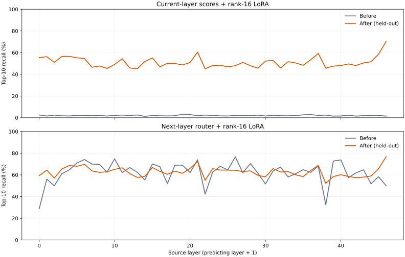

# 下一层专家预测 LoRA：首轮实测

2026-10-13。数据在家用 RX 9070 XT 上采集，小矩阵在 Spark CPU 上训练。主模型与真实路由器权重没有更新，也没有把预测器接入实际预取调度。

**当前层分数加 rank-16 LoRA 能学到预测，但命中率仍低于直接使用下一层原路由器。给下一层原路由器加 LoRA，总体只提高0.66个百分点，未缓存专家覆盖率反而下降。** 这轮得到的是一次有正有负的离线预测实验，不是推理加速结论。

## 测试集结果

每个 token、每个相邻层对单独计算：预测10个专家，与下一层真实选中的10个专家取交集，再除以10。不是把整个验证窗口的专家取并集。最终测试共有552720个真实专家选择，覆盖47个相邻层对。

| 预测方法 | 训练前 top-10 命中率 | 训练后 top-10 命中率 | 变化 |
| --- | ---: | ---: | ---: |
| 当前层分数 `xW_l + (xA)B` | 2.04% | 51.04% | +49.00个百分点 |
| 下一层现成路由器 `xW_(l+1) + (xA)B` | 62.15% | 62.81% | +0.66个百分点 |

仅按训练集专家频率固定猜10个，命中率为17.32%。当前层专家编号与下一层编号没有天然对应，第一组未训练的2.04%接近随机猜10/512≈1.95%，不能只凭它的巨大涨幅就宣布超过现成方案。

同样限制预测10个，但先排除当时已经在GPU缓存的候选，再统计真实未缓存专家：

| 预测方法 | 训练前未缓存覆盖率 | 训练后未缓存覆盖率 |
| --- | ---: | ---: |
| 当前层分数＋LoRA | 2.38% | 54.62% |
| 下一层现成路由器＋LoRA | 70.63% | 67.79% |

缓存掩码来自真实采集时的显存驻留表，比较前后使用同一份掩码。这个数是给未缓存专家的预测覆盖率，不是“装上LoRA后实际GPU缓存命中率”。尚未执行预取、没有测误传成本或端到端速度。

允许多猜候选时，总体命中率如下：

| 候选数 | 当前层＋LoRA | 下一层原路由器 | 下一层＋LoRA |
| --- | ---: | ---: | ---: |
| 10 | 51.04% | 62.15% | 62.81% |
| 14 | 60.43% | 72.16% | 72.53% |
| 20 | 69.19% | 80.18% | 80.57% |

第二组47层中有24层在测试集上下降。4个测试片段作成组配对重采样，第二组总体变化区间约为−5.39到+3.69个百分点，不能据+0.66个百分点声称稳定提升；这只有4个片段，也不能解释为跨文档泛化保证。



## 数据与训练

- 引擎源代码：Strata `7695859aa13afb248bdb4d36f9b2e95707db079d`，0.1.43，独立Windows HIP/gfx1201采集版。
- 输入：现有codex/AGENTS.md，去除完全重复的段落后，切为26个不重叠片段。原文、片段和原始数据保存在实验机及Spark工作目录，不复制进本报告。
- 18片段训练、4片段调参、4片段测试，固定seed=338。按整片段划分，不将相邻token随机分入不同集合。不是跨来源、跨任务数据集。
- 26次独立请求共34233个输入token；采集请求总耗时约283秒。使用兼容的验证窗口读取路径，`max_tokens=1`，全部请求正常完成。
- 每4个验证窗口采一次，记录所有48层的F32路由输入、真实top-10编号和完整GPU驻留掩码；强制发布新host输入，避免全缓存命中时读到旧缓冲。
- 剔除每个片段开头4个已采窗口及非6-token窗口。每层剩7896行：训练5454、调参1266、测试1176；47个相邻层对共371112行配对数据。
- 输入是当前层的输入，标签是同一token在下一层真实选中的专家；没有用下一层输入作为预测特征。
- 路由权重直接从本次安装的dense.bin/index.txt提取，为引擎实际使用的BF16权重。小样本17280个专家选择回算100%一致；全量各层回算一致率至少99.997%。训练标签始终用真实采集编号，没有替换成回算标签。
- 两个独立对照均为rank=16、无额外偏置，A随机非零初始化、B全零。训练目标为真实top-10的均匀交叉熵。AdamW，学习率0.01，weight decay=0.0001，batch=256，最多40轮；只根据调参集top-10命中率选择轮数，早停patience=8且至少12轮。
- 输入缩放仅由训练集确定，导出时吸收到A；测试使用实际导出的BF16 A/B。Torch 2.9.1+cpu，8线程。
- 当前层方案训练集命中率66.93%，测试51.04%；下一层方案训练集73.26%，测试62.81%，已经能看到过拟合差距。

便宜旁支的价值仍需实际调度实验判断：若能复用GPU上已有当前层分数，rank-16额外矩阵乘加量约为完整路由投影的3.75%；但51%的覆盖率低于原样提前运行下一层路由器的62%。本轮没有计时对照，不能单凭准确率判断哪种预取更快。

## 产物与复现

- `report.json`：各层、训练曲线、调参选轮、测试与未缓存覆盖率、汇总原始计数。
- `per-layer.csv` / `per-layer.svg`：47个相邻层对的比较。
- `groups.json`：测试片段分组计数和重采样区间。
- `dataset-summary.json` / `split-manifest.json`：数据量与片段划分；manifest只保留内容哈希。
- `route_capture.hpp` / `patch_capture.py`：采集补丁。关闭环境开关时不采集；原服务使用的发布exe没有被替换。
- `prepare_study.py` / `collect.py` / `trace_io.py` / `build_dataset.py` / `check_trace.py` / `train.py` / `evaluate_groups.py` / `export_report.py`：完整流程。

原始数据、逐层checkpoint及训练输出：

- Spark：`/home/lmxxf/work/strata-route-study/`。
- 9070 XT：`C:\Strata-Lab\route-study\`，采集服务已停止，GPU锁已释放。
- 两套导出权重均在上述目录的`weights/`，分别为`lora-current-r16.bf16.bin`与`lora-next-r16.bf16.bin`，各4620288字节（约4.62MB）。配套JSON记录矩阵布局、偏移及SHA256。导出内容逐张量与所选checkpoint比特一致。

在Spark复现训练：

```bash
python3 wechat/assets/338/route-lora/train.py /home/lmxxf/work/strata-route-study
```

这会更新该实验目录的训练结果。没有部署LoRA，也没有宣称GPU缓存命中率或生成速度提高。


## 大文件仅保留本地

仓库只提交脚本、报告、日志和清单。原始路由、派生训练数组、checkpoint、BF16权重以及打包分卷不提交；其本地位置见上文。`snapshot/manifest.json` 保留115个文件及8个归档分卷的大小和SHA256，便于核验。本地已有归档时，可用 `restore_snapshot.sh <空的目标目录>` 校验并解包；这些分卷不能通过git获取。`weights/` 只提交布局与校验信息，二进制权重仍在两台实验机本地。
