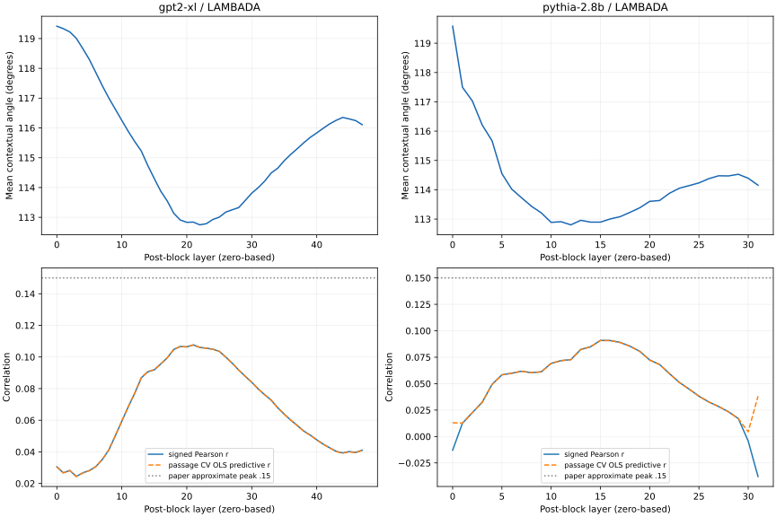
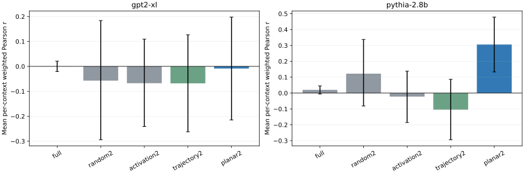

# 表征曲率与下一词元熵：GPT-2 XL／Pythia-2.8B 独立复现报告

日期：2026-11-04。论文：[arXiv:2604.23985v1](https://arxiv.org/abs/2604.23985)。本地[论文PDF](paper.pdf)与[HTML](paper.html)均已保存；本文所有模型计算在家中 DGX Spark GB10 完成，本机3080没有参与。

## 先说复现结果

**观测部分定性一致，数值较弱。32位置主因果实验中，Pythia局部平面条件为正，GPT-2 XL接近零；128个新位置的独立确认得到GPT-2 XL约0.092、Pythia约0.062，后者区间跨零。效应强度明显依赖位置选择，不能把最好的一批当成稳定量级。** 原文没有给出完整样本清单、种子及可定位代码，本次也按“够用”范围缩小了数据规模与干预位置数，因此是公式和主要控制条件对齐的独立复现，不能称逐条原始数据的严格重放。

|模型|LAMBADA篇数／有效位置|最直层（0起）|正相关峰值层|signed r|篇章CV预测r|论文文字峰值|
|---|---|---:|---:|---:|---:|---|
|gpt2-xl|1024／79398|22|21|0.1076|0.1076|约0.15|
|pythia-2.8b|1024／77130|12|15|0.0909|0.0908|约0.15|



## 1. 论文到底测了什么

主要模型确实是 GPT-2 XL（约1.5B、48层、1600维、25头、学习位置嵌入）和 Pythia-2.8B（32层、2560维、32头、RoPE）。不是聊天模型，不使用chat template。论文还分析了Pythia训练中检查点，并另外训练12层GPT-2 Small研究曲率正则；后两部分不属于本次已完成的复现。

表征曲率是**固定一层、沿词元时间轴**的几何转角，不是跨层曲率，也不是对Hessian求曲率。令x_i是该层第i个词元的block后残差状态：
```text
v_i = x_(i+1) - x_i
c_i = arccos[(v_i · v_(i+1)) / (||v_i|| ||v_(i+1)||)]
C_j = (c_(j-4) + c_(j-3) + c_(j-2)) / 3
```

C_j使用最后5个状态、3个转角，并到x_j为止。夹角除以两个位移向量的范数；不额外把x本身单位化，不除以轨迹弧长。计算中cos截断到[-1,1]防浮点越界；原始数组以弧度保存，图转为角度。0代表共线同向，π代表折返。

行为不确定性是完整词表Shannon熵：
```text
p = softmax(model_logits_at_context_endpoint_j)
H_next(j) = -sum_v p[v] * log2(p[v])   # bits，预测词元j+1
```

不是top-k熵、正确答案的负对数概率、困惑度或答题错误率。此前自家实验多用自然对数nats，换算bits=nats/ln(2)；换底只改变尺度，不改变Pearson相关系数。此前自家实验还统计过跨层1−cos曲率，并在若干层上平均；这与本论文逐层测量的三转角时间窗口不是同一统计量，不能把两组数值直接排大小。

### 一个必须公开的下标问题

原文§2.3的C_k公式会用到x_k，但§2.4写H(w_k)条件于w_<k；§2.5又说后续预测分布，§2.6明确使用H(w_(k+1))。这几处若字面照读会差一个词元。此次主分析遵循因果口径：C_j到当前状态x_j，配当前logits[j]预测下一个词元；另保存logits[j-1]与logits[j+1]两种偏移敏感性。采用j≥5、j≤T−2：至少6个上下文词元，预测序列内第7个及之后词元。没有让目标词元的隐藏状态泄露进预测它自身的曲率。

层号主分析采用block后0起算，对齐原文“首个上下文化层L0”；GPT-2 XL取21、Pythia取11。另测20／10，覆盖将21／11理解为1起算的情况，结果全部保留，不挑选更好看的层。

## 2. 数据、模型身份与复现范围

两模型权重先从官方HF仓固定revision定位，再经同文件镜像下载，最终SHA-256与HF LFS对象相同；不是另一个量化版或社区微调。全程float32，原模型参数不改，无训练、梯度或采样生成。环境与模型完整config见各模型environment.json。

- GPT-2 XL：openai-community/gpt2-xl，revision15ea56dee5df4983c59b2538573817e1667135e2。
- Pythia：EleutherAI/pythia-2.8b，revision2a259cdd96a4beb1cdf467512e3904197345f6a9。
- LAMBADA：EleutherAI/lambada_openai英文test共5153条，固定seed361打乱取1024篇，保存原始source_row_id与原文。论文仅写LAMBADA，未明确版本、split或样本数，这一语料选择及子集规模是本次与原文不可完全核对的差别。
- 短语料：UD English EWT test中10–30空格分词单词的前512句。论文5815句还要求100K常见英语名词并排除缩写，但未给词表和句子清单。因此这组只叫补充实验，不当作对原5815句结论的直接反证。
- 观测按词元逐层测量：10折OLS含截距，测试折预测与熵算Pearson r，Fisher z平均及t(df9)区间；额外按整篇文章分组，避免同篇词元跨训练/测试。固定seed361。
- 因果：32篇文本各预先固定一个内部上下文位置，6类方向各300次，共57600次扰动/model；其中五类属于论文条件，第六类是严格正交额外控制。位置并未按结果选择。作者未给原始位置清单或总位置数。

## 3. 观测实验

|模型／语料|有效预测位置|最直层|最大正相关层|signed r|token CV r及95%CI|passage CV r及95%CI|
|---|---:|---:|---:|---:|---|---|
|gpt2-xl/long|79398|22|21|0.1076|0.1077 [0.0967,0.1187]|0.1076 [0.0962,0.1190]|
|gpt2-xl/short|8346|22|0|0.0786|0.0777 [0.0576,0.0978]|0.0818 [0.0516,0.1118]|
|pythia-2.8b/long|77130|12|15|0.0909|0.0909 [0.0857,0.0961]|0.0908 [0.0831,0.0984]|
|pythia-2.8b/short|8492|12|4|0.0460|0.0459 [0.0250,0.0667]|0.0491 [0.0145,0.0836]|

层间曲率低谷与论文很接近：GPT-2 XL中层约22，Pythia约12（本文0起算）。长语料的峰值正相关也在中层，说明这个定性模式可复现；峰值只有0.108／0.091，低于论文正文约0.15。R²量级分别约1.2%和0.8%，是有用但很弱的单标量关联，不是“曲率决定绝大多数不确定性”。

短语料补充集没有重现相同的中层相关峰：这说明结果依赖数据与处理口径，但因该补充集不是作者5815句，不能直接判原结果错误。交叉验证的r必须连拟合斜率与signed原始r一起读：单标量OLS若学出负斜率，预测r也可为正，不能由预测r正号自动推断曲率越大熵越高。所有逐层原始r、斜率、折结果及偏移分析均在JSON中。

|模型／long|logits[j-1]偏移最大signed r|logits[j+1]偏移最大signed r|
|---|---:|---:|
|gpt2-xl|-0.0097|0.0494|
|pythia-2.8b|-0.0053|0.0812|

## 4. 因果干预：五类子空间与随机正交

在指定block输出只改一个位置：x_k_new=x_k+δ，||δ||=0.2||x_(k+1)−x_k||。幅度依原文使用原始完整teacher-forced序列的下一步位移；它只设干预尺度，预测熵仍来自k位置。其他历史位置在各层由因果性保持不变；采用原历史KV缓存继续后半网络，避免把相同前缀重算57600遍。

Full为全空间单位球随机方向；Random2为随机二维基；Activation2为该层残差激活全局前两PC；Trajectory2为每个样本自己的位移序列前两PC；Planar2为最近两段位移张成的平面。各条件方向采样后归一化到相同δ长度。Activation PCA用long子集有效位置每4个取1个；Trajectory PCA对位移中心化后求SVD。这些具体PCA实现细节原文未完全指定。

300次干预得到每个上下文的ΔC与ΔH，并计算逐上下文Pearson r。按附录A4使用100直方图桶、q/p重要性权重、ε=1e−12、权重截断[0.1,10]。原文参考分布汇集所有干预层的full-space；本次核心只测中层，故参考只汇集该中层，另测了直方图边界敏感性。

下表点估计为逐上下文r的算术均值，CI为独立2000次按上下文bootstrap；论文附录式Fisher汇总及CI也保存，不能把Fisher点估计的CI直接套到算术均值上。只有32个上下文，相关性的跨位置方差很大。



|模型|扰动|mean weighted r|算术bootstrap95%CI|mean raw r|Fisher pooled r|
|---|---|---:|---|---:|---:|
|gpt2-xl|full|0.0003|[-0.0205,0.0211]|0.0003|0.0003|
|gpt2-xl|random2|-0.0571|[-0.2940,0.1837]|-0.0630|-0.1416|
|gpt2-xl|activation2|-0.0674|[-0.2411,0.1092]|-0.0574|-0.1095|
|gpt2-xl|trajectory2|-0.0680|[-0.2622,0.1264]|-0.0572|-0.1408|
|gpt2-xl|planar2|-0.0086|[-0.2148,0.1977]|-0.0230|0.0385|
|pythia-2.8b|full|0.0202|[-0.0060,0.0453]|0.0202|0.0203|
|pythia-2.8b|random2|0.1221|[-0.0814,0.3377]|0.1199|0.1715|
|pythia-2.8b|activation2|-0.0222|[-0.1856,0.1377]|-0.0490|-0.0061|
|pythia-2.8b|trajectory2|-0.1048|[-0.2940,0.0868]|-0.1345|-0.1981|
|pythia-2.8b|planar2|0.3059|[0.1334,0.4786]|0.3470|0.5126|

原图4的数值未给表格，只能目测：Planar约GPT-2 XL0.28、Pythia0.23，Trajectory约GPT-2 XL0.04、Pythia0.19，其余接近0。此处不把目测当精确原始数据。

**Pythia局部平面条件得到正相关；GPT-2 XL局部平面条件未得到平均正效应，两个模型的轨迹PCA条件都没重现原文所述方向。** 原始r与加权r同时呈现，差别不只是单个权重汇总结果。这属于本次样本与实现下的未复现；样本位置、原语料、PCA与重加权未能完全相同，不能据此宣判论文造假。

### 严格正交控制的特殊情况

若δ与最近两段位移都正交且长度固定，angle_new的分母固定、分子也固定，因此ΔC对所有方向数学上恒定，Pearson相关无定义。测到的约10⁻⁸级ΔC标准差只是浮点误差，不给它算一个“零相关”或任意假相关。这个控制仍可能改变熵：

|模型|正交随机mean ΔH bits|方向间平均SD(ΔH)|
|---|---:|---:|
|gpt2-xl|0.0153|0.0957|
|pythia-2.8b|0.1321|0.1233|

所以论文“随机扰动无效”的可支持读法是**随机条件没有稳定的ΔC–ΔH耦合**，不是随机扰动完全不改变输出分布或熵。

## 5. 直接拉直／弯曲的额外测试

这不是论文五类采样的替代品。我们另在同一局部平面中沿转角梯度的负／正方向施加同范数δ，检查实测ΔC符号，并保留全部ΔH，不只挑成功个例。

|模型|操作|mean ΔC(rad)|mean ΔH(bits)|median ΔH|降低H／32|meanΔH bootstrap95%CI|
|---|---|---:|---:|---:|---:|---|
|gpt2-xl|straighten|-0.0675|-0.0303|0.0132|13/32|[-0.1325,0.0522]|
|gpt2-xl|bend|0.0675|0.0054|0.0030|15/32|[-0.0731,0.0743]|
|pythia-2.8b|straighten|-0.0717|0.0348|-0.0279|21/32|[-0.0956,0.2531]|
|pythia-2.8b|bend|0.0717|0.2624|0.0278|7/32|[0.0545,0.6267]|

操作确实使几何角度朝预期方向移动，但不保证每个词元的熵都同向变化。“一拉直就更确定、一弯曲就更犹豫”不是逐位置定律，方向、语境和其他隐变量仍重要。熵降低也不能直接叫答题变准。

## 6. 层号与直方图敏感性

下表是同样32位置、每类300次，改测将原文21／11视作1起算的相邻block；表内是未加权逐位置r均值。主实验和这一检查都保留，不选最大值冒充预定层。

|模型|相邻block(0起)|Full raw r|Trajectory raw r|Planar raw r|
|---|---:|---:|---:|---:|
|gpt2-xl|20|0.0009|-0.0621|-0.0341|
|pythia-2.8b|10|0.0065|-0.0604|0.4039|

原重加权实现将超出参考范围的样本映射边界桶；另计算了超界样本直接取最小权重0.1的敏感性结果：

|模型|条件|超出Full参考范围比例|替代边界处理weighted r|
|---|---|---:|---:|
|gpt2-xl|full|0.00%|0.0003|
|gpt2-xl|random2|0.00%|-0.0571|
|gpt2-xl|activation2|20.59%|-0.0669|
|gpt2-xl|trajectory2|16.97%|-0.0665|
|gpt2-xl|planar2|83.94%|-0.0046|
|pythia-2.8b|full|0.00%|0.0202|
|pythia-2.8b|random2|0.00%|0.1221|
|pythia-2.8b|activation2|22.74%|-0.0191|
|pythia-2.8b|trajectory2|18.59%|-0.1021|
|pythia-2.8b|planar2|90.55%|0.2422|

### 独立128位置确认（不替换主实验）

因32位置的GPT主结果接近零且区间较宽，追加一次预先冻结的确认：使用此前未干预过的第128–255篇文本，seed362在每篇第5到至多第128个上下文末位置中均匀取一个，保持原block21／11和0.2尺度、300方向。只跑Full与Planar，未搜索新层或新剂量。confirmation_plan.json在这一轮任何前向前已落盘。

|模型|条件|mean weighted r|bootstrap95%CI|mean raw r|位置数|
|---|---|---:|---|---:|---:|
|gpt2-xl|full|0.0069|[-0.0055,0.0191]|0.0069|128|
|gpt2-xl|planar2|0.0924|[0.0042,0.1890]|0.1102|128|
|pythia-2.8b|full|0.0064|[-0.0035,0.0164]|0.0064|128|
|pythia-2.8b|planar2|0.0616|[-0.0207,0.1442]|0.1191|128|

另外直接比较同一上下文中的Planar r−Full r，避免把“一组区间不跨零、另一组跨零”误当组间差异显著：

|模型|批次|配对mean r差|bootstrap95%CI|
|---|---|---:|---|
|gpt2-xl|primary32|-0.0089|[-0.1965,0.1821]|
|gpt2-xl|confirmation128|0.0854|[0.0017,0.1670]|
|pythia-2.8b|primary32|0.2858|[0.1150,0.4583]|
|pythia-2.8b|confirmation128|0.0552|[-0.0279,0.1381]|

按预定规则完整报告；位置选择和样本量都与主实验不同，因此检验的是结果能否跨另一批上下文保持，不把差别单独归因于样本量，也不只保留更接近论文的一份。


当对齐条件有大量样本位于参考直方图支持范围之外时，匹配并不完美；权重截断也使各条件的|ΔC|分布仍可能不同。本次提供原始数据和两种处理，避免把实现选择藏起来。

## 7. 原文示例与顺口溜／陷阱题

补充测试18条常规／顺口溜／陷阱文本，以及原图4提示的有无末尾空格版本。只做原始文本前向，未生成答案、未测正确率，不将这部分当智商评测。中英分词差异很大，熵大小不能直接作为“看懂了空间题”的证据。全部曲率、熵和top8见 exploratory.json。

论文图4B给出示例基线熵5.614、降低后5.543、提高后5.725；仅凭图示短提示未能精确重现其基线：

|模型|提示末尾空格|实测H_next(bits)|最高概率词元|
|---|---|---:|---|
|pythia-2.8b|False|9.3205|' first'|
|pythia-2.8b|True|3.5018|'icing'|
|gpt2-xl|False|9.6460|' first'|
|gpt2-xl|True|4.3875|'iced'|

图示是否省略了上下文、所用tokenization或其他实施细节无法核对；这个差别保留为无法还原的示例，不单凭它判原图错误。末尾一个空格就会改变BPE末位置及预测任务，本例尤其不能忽略。

## 8. 可支持的结论与不能替论文补上的结论

- 支持：两个原版模型都出现中层时间轨迹变直；在长语料上，中层曲率对后续分布熵有较弱正相关。32位置的Pythia及128位置的GPT分别出现局部平面正耦合，但没有在两批上下文上同时得到稳定量级。
- 未完整复现：约0.15的观测量级、GPT-2 XL局部平面约0.28的原图量级、跨两批上下文稳定的平面效应、两模型Trajectory PCA稳定正效应，以及UD短语料相同峰形。
- 暂不能归因为论文错误：作者未提供可定位代码、样本ID、LAMBADA版本、干预总位置数与完整下标约定；我们也缩小了规模、近似了UD过滤，并只用了中层参考分布。
- 应收窄的说法：曲率不是唯一决定H的变量；随机方向不是完全不改变H；低熵不等于知道正确答案；这些实验不测自我意识、梦境SVG、RLHF或思维链是否有用。
- 论文的训练实验属于另一个证据链：GPT-2 Small、100M tokens、BookCorpus:Wikipedia=1:3、3 seeds/条件，在7/8层加角度正则。§2.8还先筛选“tangled确实更弯、untangled确实更直”的句子再比熵；结果是这个条件子集的熵变化，不是所有句子的无条件效果。此次未运行这个昂贵训练部分，也不声称由低H证明可靠性或正确率提高。观测附录的幅度／距离比较和unigram控制回归也未重跑，所以不能只用本次观测r排除词频等混杂。

## 9. 验证、文件与复现

关键验证：Spark模型文件SHA-256与官方HF对象一致；两种架构的小模型上，缓存续算与完整重放在零扰动时一致、非零扰动时最大logit误差约10⁻⁷。真实模型各32位置也逐次检查零扰动续算误差：

- gpt2-xl：最大logit误差 0.00010681；核心GPU脚本 147.2 秒；峰值CUDA分配 7.09 GiB。
- pythia-2.8b：最大logit误差 0.00028670；核心GPU脚本 252.7 秒；峰值CUDA分配 11.54 GiB。

这证明缓存重用没有引入足以解释当前效应差异的大偏差；它不证明作者未公开的处理路径与我们相同。

文件：run_reproduction.py主实验、check_suffix.py续算验证、check_layer_index.py层号检查、run_extra.py补充案例、analyze.py汇总与作图、corpus.json固定输入、results.json总汇。各模型目录保留观测JSON／NPZ、干预原始JSON、汇总、环境config和敏感性结果。大体积数组按本机归档清单放入grocery-haven，模型权重仍在Spark，不拷回笔记本。

Spark目录：/home/lmxxf/work/curvature-icml2026-361/。按顺序运行（各模型串行）：
```bash
/home/lmxxf/work/interp-curvature-exp/venv/bin/python run_reproduction.py --model pythia-2.8b --pert-tokens 32
/home/lmxxf/work/interp-curvature-exp/venv/bin/python run_reproduction.py --model gpt2-xl --pert-tokens 32
/home/lmxxf/work/interp-curvature-exp/venv/bin/python check_layer_index.py
/home/lmxxf/work/interp-curvature-exp/venv/bin/python run_extra.py
/home/lmxxf/work/interp-curvature-exp/venv/bin/python analyze.py
```

原文来源：[arXiv](https://arxiv.org/abs/2604.23985)、[官方会议页面](https://icml.cc/virtual/2026/poster/62515)。本文按已下载v1核对。

